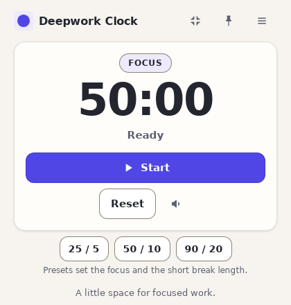

# Deepwork Clock

A calm, accessible desktop focus timer. One window, one timer, no account, no
network, no tracking. The timer keeps running in the Rust backend, so it stays
correct even when the window is hidden or the WebView is throttled.



> **Status: `0.2.0-beta.1` — a feature-complete beta candidate, not a production release.**
> The packages are unsigned, the manual screen-reader matrix has not been
> completed, and several platforms have not been exercised by hand yet. See
> [Known limitations](#known-limitations) before you rely on it.

---

## What it does

- **Countdown and focus cycles.** A single countdown (1 second to 24 hours) or
  a focus/break cycle (50/10 by default, long break after four focus phases).
- **Start, pause, resume, reset, skip, end.** Reset and end ask for
  confirmation while a phase is active; the next phase waits for an explicit
  start.
- **Main, compact and floating views.** The compact view reuses the same window
  and the same timer, so switching never pauses or resets a session. *Floating*
  is one header action (also <kbd>Primary</kbd>+<kbd>Shift</kbd>+<kbd>F</kbd>)
  that makes the window compact and asks to keep it above other windows; it is
  unavailable where pinning is unavailable, for example on Wayland.
- **A window that comes back where you left it.** Position and size are stored
  in `window-placement.json` in the app data directory and clamped to the
  current monitor work area on startup. *Reset window position* restores the
  normal size and asks the desktop to centre the window on the primary monitor;
  a compositor that owns placement may ignore the position request.
- **Settings that survive a restart.** Theme (system, light, dark, high
  contrast), text scale (100–200%), durations, session label, notifications,
  the optional completion sound (off by default, 0–100 volume, explicit
  preview), opt-in auto-advance, global shortcut, launch at login, history
  retention and the last normal/compact layout.
- **Remappable local shortcuts.** Record a new chord in *Settings →
  Shortcuts*, or reset one or all of them. An invalid, duplicate or reserved
  chord never replaces a binding that already works, and the help dialog shows
  the keys in effect.
- **Optional session names.** Name a session from the main view; earlier names
  are suggested with fuzzy search, so the same project is one keystroke away.
- **Git-friendly session logs.** Point the app at a folder in a git repository
  and it writes one human-readable Markdown file per session under
  `deepwork-sessions/`. Pull on another computer, sync again, and the sessions
  merge by filename. The app never runs git itself.
- **Crash recovery.** A running session is checkpointed; after a restart the app
  offers *Resume* or *Discard* and never silently continues.
- **Local session history.** Completed, skipped and ended phases are stored
  locally with their durations, and can be exported as CSV or JSON.
- **Redacted diagnostics.** The About view can show and copy a JSON summary of
  the version, platform, feature flags, timer state, capability states, warning
  codes and history count. It contains no labels, session identifiers, file
  paths or settings text.
- **Keyboard first.** Every action has a shortcut and every control is a real
  button or form field.
- **Offline.** No account, no analytics, no remote assets, no update check.

## What it does not do yet

Global shortcuts, tray control, notifications and launch at login are
implemented and exposed through the settings, but their behaviour differs per
desktop environment and has **not** been verified on every platform. The
completion chime is local and off by default; it has not been played on a
physical audio device in the verification environment. Automatic updates are
deliberately not implemented.

---

## Keyboard shortcuts

`Primary` is <kbd>Command</kbd> on macOS and <kbd>Ctrl</kbd> elsewhere.

| Action | Shortcut |
| --- | --- |
| Start, pause or resume | <kbd>Space</kbd> |
| Reset the current phase | <kbd>Primary</kbd>+<kbd>Shift</kbd>+<kbd>R</kbd> |
| Skip to the next phase | <kbd>Primary</kbd>+<kbd>Shift</kbd>+<kbd>N</kbd> |
| Compact or expanded view | <kbd>Primary</kbd>+<kbd>Shift</kbd>+<kbd>M</kbd> |
| Floating compact view | <kbd>Primary</kbd>+<kbd>Shift</kbd>+<kbd>F</kbd> |
| Pin the window above others | <kbd>Primary</kbd>+<kbd>Shift</kbd>+<kbd>P</kbd> |
| Open settings | <kbd>Primary</kbd>+<kbd>,</kbd> |
| Show the keyboard shortcuts | <kbd>F1</kbd> |
| Announce the remaining time | <kbd>Primary</kbd>+<kbd>Shift</kbd>+<kbd>T</kbd> |

These are the default local shortcuts. They can be remapped in *Settings →
Shortcuts*; the help dialog (<kbd>F1</kbd>) lists the bindings that are actually
in effect. Shortcuts do not fire while a text field has focus, during IME
composition, or while a key is held down. <kbd>Space</kbd> keeps its native
meaning on a focused button.

---

## Requirements

### To run a released package

| Platform | Requirement |
| --- | --- |
| Windows 11 x64 | WebView2 runtime (preinstalled on current Windows 11) |
| macOS 13 or newer (arm64 and x64) | The system WebKit, preinstalled with macOS |
| Linux x64 | GTK 3, WebKitGTK 4.1, `libayatana-appindicator3`, `librsvg2` |

The Linux packages declare their dependencies; the `.deb` is built against an
Ubuntu 24.04 baseline. The AppImage bundles most of them, but an AppImage is
not proof of compatibility with every distribution.

### Sharing sessions between computers

Choose a folder that is a git checkout in **Settings → Session sync**. The app
writes one Markdown file per finished phase to `<folder>/deepwork-sessions/`.
Commit and push that folder on one computer, pull it on the other, then press
**Sync now**; files are merged by a unique session id, so duplicates are
ignored. The app does not run git, resolve conflicts or read files outside the
`deepwork-sessions` subfolder. Removing the folder path switches the feature
off.

### Linux desktops: i3, Regolith and Wayland

Tiling window managers, including i3 and Regolith, ignore a requested window
size while the window is tiled. The **Floating** action asks i3 (or sway) over
its IPC socket to float the window before applying the compact size, so the
button works without extra configuration on those desktops. When the IPC
socket is unavailable, the window manager still owns the result.

If you prefer the timer to be floating for every launch, add this rule to your
i3 configuration and reload it (`i3-msg reload`):

```
for_window [class="Deepwork-clock"] floating enable
```

Regolith's i3 session uses i3 underneath, so the same rule applies there.
Whether a floating window stays above other applications is still up to the
window manager: i3 may ignore the always-on-top request.

On Wayland the compositor owns window placement and keep-above. The app reports
floating and pinning as unavailable there, and a saved position is a hint at
most. Desktop-specific placement and compositor rules remain the user's
responsibility.

### To build from source

- Rust `1.95.0` (pinned in `rust-toolchain.toml`)
- Node.js `24.11.1` and npm `11.6.2`
- Linux build dependencies: `libgtk-3-dev`, `libwebkit2gtk-4.1-dev`,
  `libayatana-appindicator3-dev`, `librsvg2-dev`, `patchelf`, `libxdo-dev`
- Tauri 2 prerequisites for your platform, see
  <https://v2.tauri.app/start/prerequisites/>

---

## Build, test and run

```bash
npm ci                 # install the pinned JavaScript dependencies
npm run typecheck      # strict TypeScript check
npm run lint           # ESLint
npm test -- --run      # Vitest unit and DOM tests
npm run test:scripts   # Node tests for the release tooling
npm run build          # typecheck + production frontend bundle
npm run tauri dev      # run the desktop app with hot reload
npm run tauri build    # produce native packages in src-tauri/target/release/bundle
```

Useful extras:

```bash
npm run verify:versions   # every version field must agree
npm run verify:icons      # the native icon set must be valid and correctly sized
npm run icons:generate    # regenerate the icons from src-tauri/icons/source/*.svg
npm run notices           # generate THIRD_PARTY_NOTICES.md from the lockfiles
npm run test:a11y         # Playwright + axe checks against the development preview
```

Rust checks (run from the repository root):

```bash
cargo fmt --manifest-path src-tauri/Cargo.toml --check
cargo clippy --manifest-path src-tauri/Cargo.toml --all-targets -- -D warnings
cargo test --manifest-path src-tauri/Cargo.toml
cargo test --manifest-path src-tauri/src/core/Cargo.toml
cargo test --manifest-path src-tauri/src/engine/Cargo.toml
```

The `core` and `engine` crates are independent of the desktop shell, so they
can be built and tested without a windowing system.

### Install and uninstall

- **Windows (NSIS `.exe`):** run the installer, then uninstall from
  *Settings → Apps → Deepwork Clock*. The installer is unsigned, so
  SmartScreen may ask for confirmation.
- **macOS (`.dmg`):** open the disk image and drag the app to *Applications*.
  Remove it by dragging it to the Trash. The packages are not notarized, so
  Gatekeeper may block the first start.
- **Linux (`.deb`):** `sudo apt install ./deepwork-clock_*.deb`. Uninstall with
  `sudo apt remove deepwork-clock`.
- **Linux (AppImage):** make it executable (`chmod +x`) and run it. Delete the
  file to uninstall.

Your settings, history and recovery data are written to the platform
application data directory and are **not** removed by the uninstaller. Delete
that directory manually if you want a clean slate; the exact path is shown in
the app.

---

## Privacy

Deepwork Clock works entirely offline.

- No account, no telemetry, no analytics and no crash reporting.
- No network requests at runtime; the frontend loads no remote assets or fonts.
- Session labels and history stay on your machine and are only exported when you
  ask for it.
- The About diagnostics are generated locally and redacted before they are
  shown. They contain no session labels, identifiers, absolute user paths or
  settings text, and nothing is sent anywhere.
- The optional global shortcut is registered with the operating system, not
  with a remote service. The app never captures the keyboard outside its own
  window.

---

## Repository layout

```
src/                     frontend (vanilla TypeScript, no framework)
src-tauri/src/engine/    pure timer engine crate (no Tauri, no I/O)
src-tauri/src/core/      storage, history and service logic crate
src-tauri/src/           Tauri shell: commands, platform adapters
src-tauri/icons/         generated native icons and their SVG sources
scripts/                 versioning, icon and release tooling
tests/frontend/          frontend tests
.github/workflows/       CI and release pipelines
docs/                    plan, task cards, handoff and evidence
```

## Accessibility

The interface targets WCAG 2.2 AA and WCAG2ICT for the desktop behaviour: a
single `role="timer"` element with `aria-live="off"`, one polite live region
for state changes, real buttons and labelled fields, visible focus, a 44 px
minimum target size and a text scale up to 200%. Every action has a keyboard
path, and local shortcuts can be remapped in the settings.

Automated axe runs in CI are a supplement only. The screen-reader matrix
(NVDA, Narrator, VoiceOver, Orca) is still open work and is listed as a known
limitation.

## Licence

[MIT](LICENSE). The application icon, the tray glyphs and the completion chime
are original assets created for this project and are covered by the same
licence; no third-party icon, font or sound asset is bundled. The licences of
the bundled dependencies are listed in the `THIRD_PARTY_NOTICES.md` file that
is attached to every release.

## Known limitations

- **Unsigned packages.** No Windows Authenticode signature, no Apple Developer
  ID signature and no notarization. Signature and notarization require
  maintainer-held credentials and are still open work.
- **No manual screen-reader verification yet.** The automated axe run does not
  replace the per-OS reader script (NVDA, Narrator, VoiceOver, Orca) that the
  project plan requires before a 1.0 release.
- **Advertised is not verified.** The plan targets Windows 11 x64, macOS arm64
  and x64 and Linux x64. The toolkit supports more platforms than that; this
  project only claims the targets above. Local Linux X11 builds and an installed
  `.deb` have been exercised; no Windows or macOS runtime has been run, and no
  release artifact is published yet.
- **Completion sound playback is unverified.** The bundled 0.7 s chime is off
  by default, never loops and is swallowed if the audio device or autoplay
  policy refuses. It was not played on a physical audio device during
  verification, so treat it as best effort; the visual completion is the
  authoritative signal.
- **Floating and compact sizes depend on the window manager.** On Wayland the
  app reports floating and pinning as unavailable instead of pretending they
  work. On X11 tiling window managers the requested size is ignored unless you
  add the i3/Regolith floating rule above; whether the window stays above other
  applications is still up to the window manager. A virtual display without a
  window manager cannot confirm that an always-on-top request was honoured.
- **Window placement is best effort.** Saved position and size are clamped to a
  visible work area and fall back to the primary monitor when the remembered
  monitor is gone. Wayland compositors own placement, so the saved coordinates
  are only a hint there.
- **Auto-advance is opt-in and only for awake time.** The next phase starts by
  itself only after a completion observed within a 3-second sampling gap in
  cycle mode. After a suspend or an uncertain gap the completed phase waits for
  an explicit action; after a restart, the checkpoint is offered as recovery and
  never resumes by itself.
- **Global shortcuts, tray, notifications and launch at login** behave
  differently per desktop and are not yet verified on every platform. The
  settings report what the current desktop supports. On Wayland there is no
  general global-hotkey path in this build; the capability is reported as
  unavailable rather than silently failing.
- **Resource budgets** in the plan (memory, CPU, startup time) are targets;
  no measured numbers are published for this alpha.
- **No automatic updates.** Updating means downloading a new package.

## Contributing

See [CONTRIBUTING.md](CONTRIBUTING.md). Please read
[CODE_OF_CONDUCT.md](CODE_OF_CONDUCT.md) and report security problems
according to [SECURITY.md](SECURITY.md).

## Release history

See [CHANGELOG.md](CHANGELOG.md).
